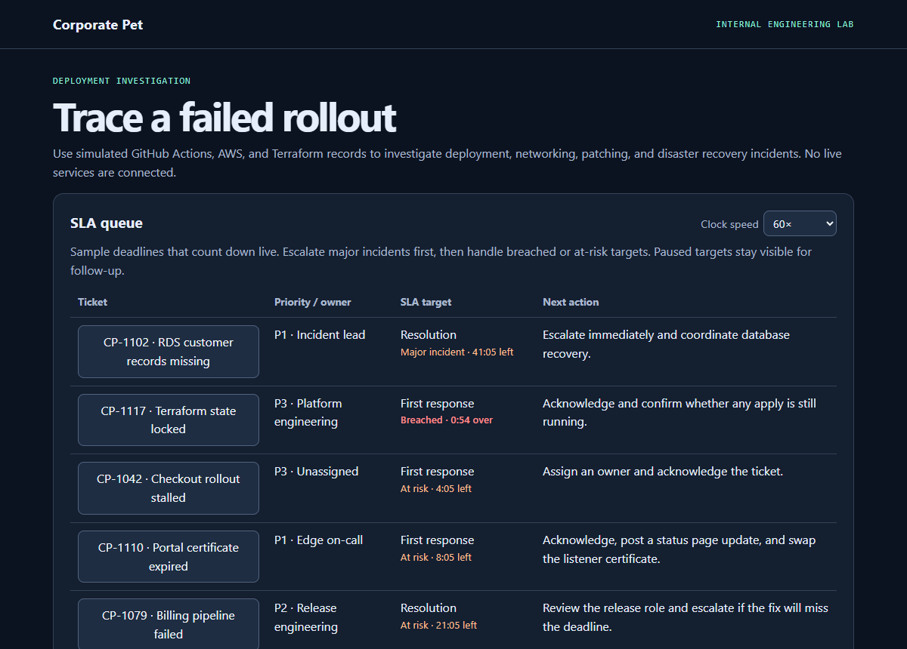

# Guided

A browser-based trainer for triaging cloud operations incidents. Work a live SLA queue, read simulated GitHub Actions, AWS, and Terraform evidence, choose the first useful action, follow a step-by-step runbook, and export an incident report.

**Live demo:** https://gkoufie1.github.io/guided/




## What it does

- **Live SLA queue.** Deadlines count down in real time (or at 10× / 60× for demos) and the queue re-ranks itself: major incidents, then breached, at-risk, on-track, and paused tickets.
- **Seven incidents** across deployments, IAM, TLS, Terraform state, networking, patching, and data recovery.
- **Two modes.** *Manual* hides the finding until you choose correctly. *Guided* shows the expert finding and runbook up front.
- **Feedback on wrong answers.** Every wrong option explains which piece of evidence rules it out.
- **Runbook notes.** Record what you actually see at each step. Notes stay in this browser.
- **Incident report.** Download or copy a Markdown write-up with the ticket, evidence, action taken, options ruled out, your step notes, and the customer reply draft.
- **Progress tracking.** Cases solved, first-try accuracy, and average time to solve.

| Case | Incident | Root cause |
|---|---|---|
| CP-1042 | Checkout rollout stalled | Deployment references an image tag missing from ECR |
| CP-1079 | Billing pipeline failed | IAM role trusts the old repository's OIDC subject |
| CP-1091 | Oracle host froze during a STIG scan | Memory pressure on a 4 GB host with no swap ([PatchPilot](https://github.com/gkoufie1/patchpilot)) |
| CP-1102 | Customer records missing | Accidental DELETE; point-in-time restore to a new RDS instance ([DR Drill 002](https://github.com/gkoufie1/aws-saas-sre-disaster-recovery-lab/blob/main/docs/dr/dr-drill-002-rds-pitr-results.md)) |
| CP-1110 | Portal certificate warning | ALB still serves an expired imported certificate |
| CP-1117 | Terraform state locked | A cancelled apply left a stale lock |
| CP-1123 | Orders API database timeouts | RDS security group still allows the retired app security group |

CP-1091 and CP-1102 are based on real lab work. The others are realistic samples.

Open a case directly with `?case=<id>`, for example [`?case=CP-1110`](https://gkoufie1.github.io/guided/?case=CP-1110). It opens in guided mode.

## Backend: runbook suggestions on live tickets

The same runbooks can be suggested on real tickets. When an incident is created in **ServiceNow** or **ManageEngine ServiceDesk Plus**, a serverless backend on AWS matches it against the runbook library and posts the closest runbook back as an internal note, with a link into the trainer.

```
Ticket created → API Gateway → Receiver Lambda (auth, redact) → SQS → Worker Lambda (match) → work note on the ticket
```

- Matching is rule-based and explainable: each note lists the phrases that matched, and nothing is posted below the confidence threshold.
- Personal data and secrets are redacted before the ticket is queued. Ticket text is never logged or stored.
- At-least-once delivery is handled with DynamoDB conditional writes, so each ticket gets one note. Failures retry individually, then land in a dead-letter queue with an alarm.
- Python 3.12 standard library only, deployed with Terraform.

Read the [architecture and design decisions](docs/architecture.md), then set up [ServiceNow](docs/integrations/servicenow.md) or [ServiceDesk Plus](docs/integrations/manageengine.md).

```sh
cd backend/terraform
cp terraform.tfvars.example terraform.tfvars   # set your profile and alert email
terraform init && terraform apply
```

Not yet tested end to end against a live ServiceNow or ServiceDesk Plus instance.

## Run locally

Open `index.html` in a browser. There is no build step, and no dependencies or credentials are needed.

## Tests

Requires Node.js 18 or later and Python 3.10 or later. No packages are installed.

```sh
npm test               # trainer, plus a check that the backend's runbooks.json matches cases.js
npm run test:backend   # backend parsing, redaction, matching, handlers, and API clients
```

The trainer tests cover SLA ranking and breach transitions, the incident report, and the shape of every case (one correct option, a hint for each wrong one, unique runbook step ids, matching signals, and an SLA entry).

## Project layout

| File | Purpose |
|---|---|
| `index.html` | Page structure and styles |
| `cases.js` | All incident data: evidence, options and hints, runbooks, reply drafts, SLA entries |
| `sla.js` | SLA ranking and status text (pure functions) |
| `report.js` | Markdown incident report builder |
| `app.js` | UI wiring, live queue, progress, and browser storage |
| `tests/` | Node test runner suites |
| `scripts/export-runbooks.js` | Generates the backend's `runbooks.json` from `cases.js` |
| `backend/src/guided_backend/` | Lambda code: ticket parsing, redaction, matching, notes, help desk clients |
| `backend/tests/` | Backend unit tests |
| `backend/terraform/` | API Gateway, Lambda, SQS, DynamoDB, SSM, IAM, and alarms |
| `docs/architecture.md` | Backend design, decisions, security model, and failure modes |
| `.github/workflows/pages.yml` | Runs all tests and Terraform validation, then deploys to GitHub Pages |

## Add a case

Append an object to `cases.js` using the same shape as the existing ones, including `signals`: lowercase phrases (error strings, symptoms) that identify the incident in a ticket. Then run `npm run export-runbooks` and `npm test`. The case shows up in the picker, the SLA queue, the progress panel, and the backend's runbook library.

## Scope

All tickets, evidence, and SLA deadlines in the trainer are sample data, and the trainer itself does not connect to a help desk, cloud account, or AI service. Notes and progress are stored only in your browser's `localStorage`. The optional backend runs in your own AWS account; check your organisation's policy before connecting it to a real ticket queue.
