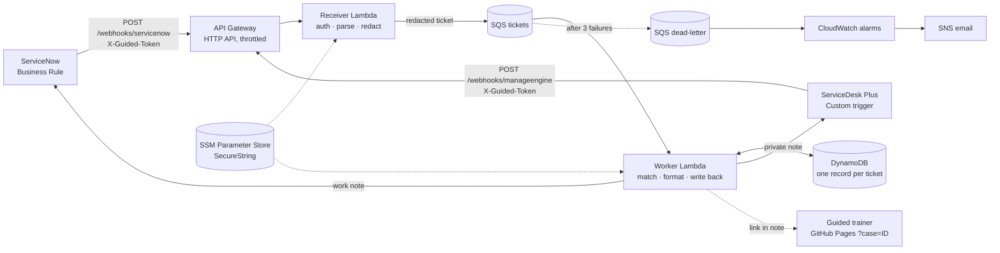

# Guided backend: architecture

Guided suggests runbooks for incoming help desk tickets. When a ticket is created in ServiceNow or ManageEngine ServiceDesk Plus, Guided matches it against a library of known incidents and posts the closest runbook back to the ticket as an internal note, with a link to walk through it in the Guided trainer.

It suggests. It never changes anything in the customer's environment, and every note says so.

## Goals and non-goals

**Goals**
- Put the right runbook in front of the engineer within seconds of a ticket being created.
- Work with more than one ticketing system through the same core.
- Keep customer data minimal, redacted, and inside the AWS account.
- Never lose a ticket silently, never post twice, and never take the help desk down with a burst.
- Cost close to nothing at demo volume, within a $40/month personal AWS budget.

**Non-goals (for now)**
- Automatic remediation. A person decides what to do.
- Free-form AI diagnosis. Matching is rule-based and explainable; an AI step is planned for tickets the rules miss (see [Roadmap](#roadmap)).
- A user interface for reviewing suggestions. The ticket itself is the interface.

## Architecture

### Request flow
1. A ticket is created. The ticketing system sends a small JSON payload to `POST /webhooks/{system}` with a shared token header.
2. **Receiver** checks the token (constant-time compare), picks the parser for `{system}`, validates the payload, keeps only the fields needed, redacts personal data and secrets, puts the ticket on the queue, and returns `202 Accepted`. It does no slow work, so the webhook returns in milliseconds.
3. **Worker** takes tickets from the queue in small batches. For each one it:
   1. claims the ticket in DynamoDB with a conditional write (so a duplicate delivery is skipped),
   2. scores it against the runbook library,
   3. if the match is strong enough, formats a note and writes it back through the ticketing system's REST API,
   4. records the outcome (`posted`, `no_match`, or `failed`).
4. A failed write-back is retried by SQS on its own (partial batch response). After three attempts it moves to the dead-letter queue, which raises an alarm.

### Components

| Component | Responsibility | Why this choice |
|---|---|---|
| API Gateway HTTP API | Public HTTPS endpoint, routing by system, throttling, access logs | Cheapest managed HTTPS front door. Stage throttling caps cost even if the token leaks. |
| Receiver Lambda | Authenticate, parse, minimise, redact, enqueue | Keeps the webhook fast and makes redaction happen before data is stored anywhere. |
| SQS + DLQ | Buffer between intake and processing | Absorbs bursts, survives help desk outages, and makes failures visible instead of lost. |
| Worker Lambda | Match, write back, record | Concurrency capped at 2 so a ticket storm can't overload the help desk's API. |
| DynamoDB | Idempotency and audit record per ticket | Webhooks and SQS are at-least-once; conditional writes make processing exactly-once in effect. Stores no ticket text; 30-day TTL. |
| SSM Parameter Store | Webhook token and help desk credentials | SecureString, free at standard tier. Values are set out of band, never in Terraform state or git. |
| CloudWatch + SNS | Alarms on dead letters and Lambda errors | The two signals that mean a ticket didn't get its suggestion. |
| Runbook library | `runbooks.json`, generated from the trainer's `cases.js` | One source of truth: the runbook an engineer practises on is the one suggested on a live ticket. A test fails if they drift. |

### Integration points

The core only knows about a normalised `Ticket`. Each ticketing system needs two small adapters:

| System | Inbound (parser) | Outbound (client) |
|---|---|---|
| ServiceNow | Async Business Rule on `incident` insert sends `sys_id`, `number`, `short_description`, `description`, `category`, `cmdb_ci` | `PATCH /api/now/table/incident/{sys_id}` with `work_notes`, Basic auth, integration user with the `itil` role |
| ServiceDesk Plus (on-prem) | Custom trigger webhook sends `id`, `display_id`, `subject`, `description`, `category`, `asset` | `POST /api/v3/requests/{id}/notes` with `show_to_requester: false`, technician API key |

Adding Jira Service Management or Zendesk means writing one parser and one client. Nothing else changes.

Setup steps: [ServiceNow](integrations/servicenow.md) · [ServiceDesk Plus](integrations/manageengine.md).

## Key decisions

### Serverless (Lambda) instead of Kubernetes (EKS)
The workload is event-driven, bursty, and idle most of the time. On Lambda it costs nothing when idle and scales per request. An EKS control plane alone costs about $73/month before any nodes, which is more than this project's whole budget, and would add cluster upgrades and node patching for no benefit at this scale.

EKS would become the better fit if Guided grew into several long-running services (for example a self-hosted model server, or a review UI with steady traffic), or if a client standardised on Kubernetes. The code is structured so that could happen without a rewrite: handlers are thin wrappers around plain functions (`receiver.handle`, `worker.process`) that could sit behind a container web server or queue consumer instead.

### Queue between intake and processing
Without the queue, the webhook would wait for matching and for the help desk API. A slow or unavailable help desk would then cause webhook timeouts, and some systems don't retry webhooks. With the queue, intake succeeds as long as AWS is up, and processing catches up.

### Rule-based matching before AI
Each runbook lists signal phrases (error strings, product names, symptoms). The runbook with the most distinct phrases present wins, and at least two must match before anything is posted. The note lists the phrases that matched.

This is deliberately simple: it is explainable, testable, free to run, and sends no ticket data to a third party. Its weakness is recall: tickets described in unexpected words won't match. That is the gap an AI step should fill, rather than replacing the rules.

### No suggestion is better than a wrong one
A wrong suggestion wastes an engineer's time and erodes trust in every later note. The threshold (`min_signals`, default 2) and the "medium/high" confidence label are tuned for precision. Tickets that don't match are recorded as `no_match` so the miss rate can be measured and the runbook library improved.

### Standard library only
The Lambda package has no third-party dependencies (HTTP via `urllib`; `boto3` is provided by the runtime). No build step, no layers, no supply-chain surface to patch, and cold starts stay short.

## Security

| Concern | Control |
|---|---|
| Who can submit tickets | Shared secret in `X-Guided-Token`, compared in constant time. Token stored as SecureString and cached for 5 minutes, so rotation takes effect without a redeploy. |
| Abuse and cost | API Gateway throttling (5 rps steady, 10 burst by default), 64 KB body limit, worker concurrency cap. |
| Injection into write-back URLs | Ticket ids are validated (`sys_id` is exactly 32 hex characters; SDP ids are digits only) before they reach a URL. Help desk base URLs must be `https://`. |
| Customer data | Parsers read only the fields needed; caller contact fields are never read. Free text is redacted (emails, phone numbers, AWS keys, GitHub tokens, bearer tokens, private keys, `password=`-style values) in the receiver, before the queue. Ticket text is never logged or stored in DynamoDB. |
| Data at rest | SQS and DynamoDB encryption enabled; SSM SecureString with the AWS managed key. |
| Least privilege | Separate IAM role per function. The receiver can only send to one queue and read one parameter. The worker can only consume that queue, write that table, and read the two credential parameters. |
| Help desk credentials | Dedicated integration user per system with only the rights to write notes. Stored in SSM, never in code, Terraform state, or git. |
| Visibility | Structured JSON logs (ticket number, outcome, runbook id, latency, redaction counts), API access logs, alarms on dead letters and errors. |

**Known gaps:** the shared token is replayable if intercepted (TLS mitigates this); HMAC request signing or mutual TLS would be stronger. ServiceDesk Plus Cloud uses Zoho OAuth, which the client doesn't implement yet.

## Failure modes

| Failure | What happens | Recovery |
|---|---|---|
| Help desk API down or credentials wrong | Write-back raises; that ticket's claim is released and SQS retries it alone | After 3 attempts → DLQ → alarm. Fix the cause, then redrive the DLQ. |
| Same ticket delivered twice | Second claim fails the DynamoDB condition | Skipped and logged as `duplicate_skipped`. |
| Worker crashes mid-ticket | Claim stays `processing` | Becomes reclaimable after 5 minutes; SQS redelivers. |
| Burst of tickets | Queue grows; 2 workers drain it | No action. Raise `maximum_concurrency` if lag matters. |
| Malformed or hostile payload | Receiver returns 400/401/404/413 | Nothing queued. Visible in access logs. |
| Ticket matches nothing | Recorded as `no_match`, no note | Review `no_match` records to find runbooks worth writing. |

## Scalability

- **Intake** scales with API Gateway and Lambda; the practical ceiling is the throttle you set.
- **Processing** is limited on purpose by worker concurrency, because the help desk API is the real bottleneck. Each worker handles up to 5 tickets per invocation.
- **Matching** is O(runbooks × signals) string checks per ticket, well under a millisecond for hundreds of runbooks. At thousands of runbooks, move to an inverted index or embeddings.
- **DynamoDB** is on-demand and keyed by ticket, so there are no hot partitions.

## Cost

At demo volume (hundreds of tickets a month) nearly everything stays inside the AWS free tier or rounds to cents. The main fixed cost is the three CloudWatch alarms at about $0.10 each per month. Lambda, SQS, API Gateway, DynamoDB on-demand, standard SSM parameters, and SNS email are pay-per-use. `terraform destroy` removes everything.

## Testing

- **Unit tests** (`npm run test:backend`, standard library `unittest`): parsing and id validation, redaction (including that technical evidence survives), matching against realistic first reports worded differently from the sample cases, no-match on unrelated tickets, word-boundary checks, note format, receiver status codes, worker idempotency and partial-batch retries, and the exact HTTP requests sent to each help desk.
- **Contract test** (`npm test`): `runbooks.json` must match `cases.js`.
- **CI** runs both, plus `terraform fmt -check` and `terraform validate`, before every Pages deploy.

Not yet tested end to end against a live ServiceNow or ServiceDesk Plus instance.

## Roadmap

1. **End-to-end test** against a ServiceNow Personal Developer Instance.
2. **Feedback loop:** when a ticket closes, record whether the suggested runbook was the actual fix; report precision per runbook.
3. **AI fallback** for `no_match` tickets: send the already-redacted text and the runbook library to Claude through a company-approved account, ask for the closest runbook or "none", and label the note as AI-generated. Rules stay first because they are free, fast, and explainable.
4. **Live evidence:** read-only checks the worker can run to confirm a match (certificate expiry, ECR tag present, security group rules), shown in the note as evidence.
5. **Stronger webhook auth:** HMAC signatures.
